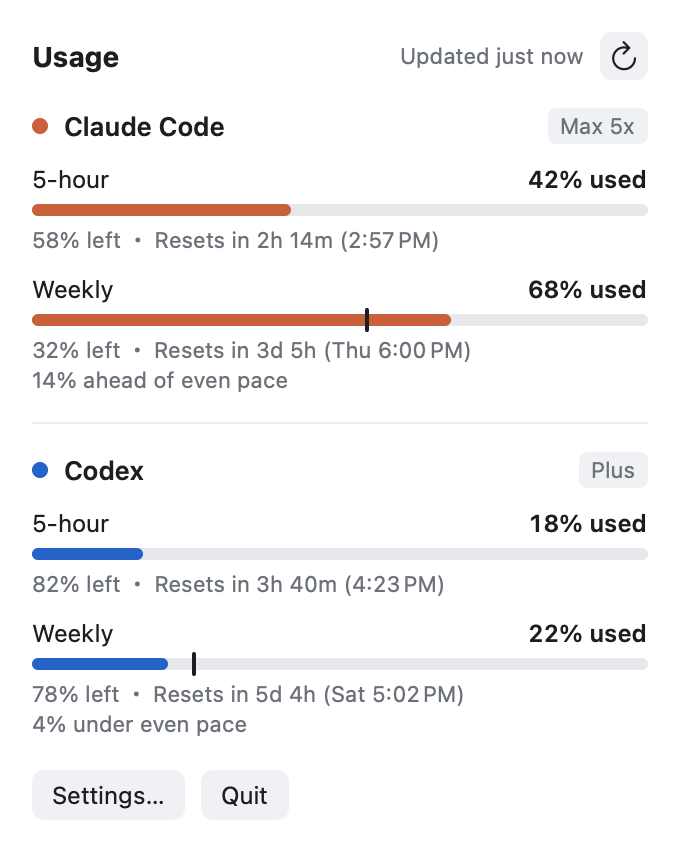
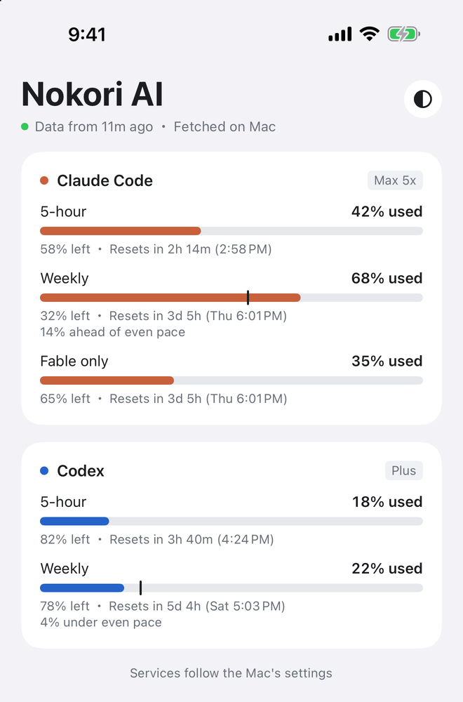
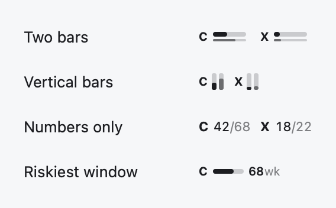

# Nokori AI

See how much of your Claude Code and Codex subscription is left — the 5-hour and weekly limits — in the Mac menu bar and on iPhone widgets.

- **Mac**: a menu bar meter (four styles) and a popover with reset times and whether you are ahead of an even weekly pace
- **iPhone** (optional, not on the App Store yet): an app and Home Screen / Lock Screen widgets that show what your Mac fetched, synced through your own iCloud

<p>
  <picture><source media="(prefers-color-scheme: dark)" srcset="docs/images/popover-dark.png"></picture>
  <picture><source media="(prefers-color-scheme: dark)" srcset="docs/images/iphone-dark.png"></picture>
</p>

Four menu bar styles:

<picture><source media="(prefers-color-scheme: dark)" srcset="docs/images/presets-dark.png"></picture>

<sub>Screens show sample numbers.</sub>

Nokori AI is not affiliated with, endorsed by, or sponsored by Anthropic or OpenAI. "Claude", "Claude Code", "Codex" and "ChatGPT" are trademarks of their respective owners.

## Requirements

- macOS 14 or later; iPhone with iOS 17 or later for the widgets
- Claude Code signed in with a Claude Pro or Max plan, and/or the Codex CLI signed in with a ChatGPT plan. API-key sign-ins have no subscription limits to show

## Install

1. Install with [Homebrew](https://brew.sh):

   ```bash
   brew install --cask int314/tap/nokori-ai
   ```

   Or download the latest `Nokori AI` from [Releases](../../releases), move it to Applications and open it. It lives in the menu bar; there is no Dock icon.
2. The first time it reads your Claude Code sign-in, macOS asks whether Nokori AI may use the "Claude Code-credentials" keychain item. See [the keychain prompt](#the-keychain-prompt).
3. For the iPhone, once its app is out, sign in to the same Apple Account on both devices and keep "Sync to iPhone" on in the Mac app's settings.

The app checks for updates once a day and offers them; turn that off or check now under **Updates** in its settings. Neither service promises the way usage is read here, so updates are how fixes reach you.

## How it gets the numbers

Neither service publishes an API for subscription usage. Nokori AI uses what the official tools themselves use, so it can break without notice when they change.

- **Claude Code**: reads the sign-in Claude Code stores in your keychain (or `~/.claude/.credentials.json`) and asks Anthropic's usage endpoint, identifying itself as Nokori AI
- **Codex**: starts your installed `codex` in read-only mode (`codex -s read-only -a never app-server`) and asks it for the account's rate limits

Nokori AI only reads. It never refreshes or writes either tool's credentials, keeps them in memory only, and sends them nowhere but the service they belong to. Claude Code's sign-in lasts about eight hours and only Claude Code renews it, so when it has expired Nokori AI starts `claude` for a few seconds in an empty folder of its own (no hooks, no MCP servers, nothing sent to the model) and lets it renew itself — useful on days you only use the Claude desktop app, which does not renew it. The iPhone receives the percentages and reset times through your private iCloud database — never credentials.

## The keychain prompt

Claude Code keeps its sign-in in the macOS keychain, and macOS asks before another app reads it. Nokori AI never shows that prompt on its own schedule; automatic refreshes only read what is already allowed. When access is missing, the popover shows **Allow**, and pressing it brings up the prompt.

Claude Code writes that item with Apple's `/usr/bin/security` tool, so Nokori AI reads it through the same tool when the item's access list already trusts it. In that case no prompt appears even after Claude Code renews its sign-in. Otherwise you may be asked again after a renewal.

## Building from source

Requires a current Xcode and [XcodeGen](https://github.com/yonaskolb/XcodeGen).

```bash
xcodegen generate
open NokoriAI.xcodeproj
```

A fork needs its own identifiers, because iCloud containers and App Groups belong to one developer team. Replace these with yours:

- `DEVELOPMENT_TEAM` and the `PRODUCT_BUNDLE_IDENTIFIER`s in `project.yml`, and the Mac target's provisioning profile name
- the iCloud container `iCloud.dev.int314.nokori` in the three `.entitlements` files and `Packages/UsageCore/Sources/UsageCore/CloudSync.swift`
- the App Group `group.dev.int314.nokori` in the iPhone and widget `.entitlements` files and `Packages/UsageCore/Sources/UsageCore/SharedStore.swift`
- the update feed and key: `SUFeedURL` and `SUPublicEDKey` in `project.yml` (make your own key with Sparkle's `generate_keys`), and `repo=` in `scripts/release-mac.sh`. Otherwise your builds would offer this project's releases as updates

Then register the iCloud container and App Group in your Apple Developer account.

## License

[MIT](LICENSE)
